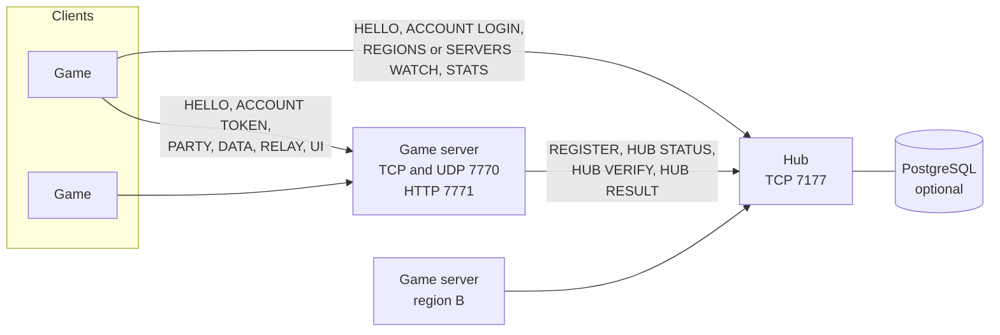

# Architecture

There are three parts: clients (the games), one hub, and any number of game servers.

- **The hub** (`:hub`, default port 7177, TCP) keeps the accounts and stats and lists the game
  servers that registered with it. It is the only part that talks to the database. See
  [hub.md](hub.md), [accounts.md](accounts.md) and [stats.md](stats.md).
- **A game server** (`:server`, default port 7770, TCP and UDP) runs the lobbies and game rooms:
  parties, adverts, relays. It links players and forwards their traffic without reading the game
  data, and the host's game is authoritative. See [game-server.md](game-server.md).
- **A client** is a game running on OpenRAC. It reaches a hub through the launcher's server setting
  (`OPENRAC_SERVER`, host and port), by default `hub.openrac.dev:7177`.

This follows the online games' own split: an authentication server with a list of lobby servers,
then the lobby and the games of the one chosen. Up Your Arsenal's login maps onto the hub's
accounts, and its city select onto the list (one city per listed server, named by its region).

## Connection flow

1. **A game server registers.** It connects to `HUB_ADDRESS` and sends `REGISTER`. The hub answers
   `HUB REGISTERED` with the server's id, or an `ERROR` and closes.
2. **It keeps in step.** It sends `HUB STATUS` every `REGION_REPORT_SECONDS` with its player and
   party counts, and `HUB CLOSING` when it shuts down.
3. **A player reaches the hub.** Its client says `HELLO`, then `ACCOUNT LOGIN`. It asks `REGIONS`
   for a snapshot of the list, or `SERVERS WATCH` for every server and then each change.
4. **It picks a game server** and connects there: `HELLO` as before, then `ACCOUNT TOKEN` with its
   session token. The game server asks the hub (`HUB VERIFY`) and answers `ACCOUNT LOGGED_IN` or
   `SESSION_INVALID`. A player that sends no token plays under its `HELLO` name, as before accounts.
5. **It plays.** It creates, finds or joins a party, and the game server forwards `DATA`, `RELAY`
   and UDP `STATE` between the members. When a game ends, the server sends `HUB RESULT` with the
   scoreboard.

The details of each step are in [hub.md](hub.md), [accounts.md](accounts.md) and
[game-server.md](game-server.md); the packets are in [protocol.md](protocol.md).

## Packet handling

Each service keeps its network code in the same shape (see [protocol.md](protocol.md) for the wire):

- **`:common`** holds `Packets`, `Opcodes`, the buffers, the outgoing packets
  (`net/packets/out/`) and `IncomingPacket<C>`, the base of every packet a service receives. It
  says whether the packet is `strict` (the connection must have said hello or registered first) and
  which per-connection rate limit it draws from, and its `handle(connection, payload)` does the work.
- **A `PacketRouter`** per service (`com.openrac.server.net.packets`, `com.openrac.hub.net.packets`)
  maps each `Packets` value the service takes to its `Incoming<Name>Packet`, registered in one
  static block. A game server has two maps: players' connections and the link to the hub.
  A packet with no entry is not taken, and the sender is closed.
- **One class per packet**, under `game/in/` and `hub/in/` on a game server and `in/` on the hub.
  The opcodes of a packet are switched inside its class, one private method each.
- **The Netty handler** (`GamePacketHandler`, `HubPacketHandler`) is thin: it decodes, looks the
  packet up, refuses a strict packet before login, applies the rate limit, and calls `handle`.
  It also admits and cleans up the connection. Per-connection state lives in the service's
  `Connection`, which the packets read and change.

## Modes

`MODE` picks a game server's role:

| Mode | Runs |
| --- | --- |
| `region` (default) | lobbies and game rooms, registered with the hub at `HUB_ADDRESS` (`hub.openrac.dev:7177`) |
| `all` | the same, plus a hub on `HUB_PORT` (7177) in the same process, which the server registers with over loopback: one box for a LAN party or a group of friends |

The hub alone runs from its own jar (`./scripts/run_hub.sh`, or `hub.jar` in the image). Ctrl+C
(or SIGTERM) closes the ports and shuts the event loops down. A game server tells its hub it is
closing first, so players stop being sent to it.
